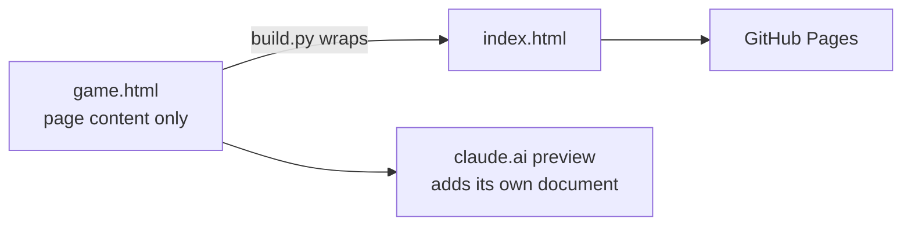

# Cake Stack

A one-tap stacking game for Lauren and Jackson's wedding website (OceanCliff, 2 September 2027).

Tap to drop each tier of the cake. Whatever hangs over the edge is sliced off. Three perfect
drops in a row and the cake starts growing back. Every score on the leaderboard becomes a flag
on the way up, so you watch yourself climb past the rest of the family.

**Play:** https://jtwood25-2.github.io/lj-cake-stack/

## How it is built



| File | Role |
|---|---|
| `game.html` | The whole game: canvas rendering, sound, leaderboard client. No `<html>`/`<head>`. |
| `build.py` | Wraps `game.html` into `index.html` for static hosting. |
| `index.html` | Generated. Do not edit by hand. |

## Design decisions

- **Deterministic scoring.** A tier's position is a closed-form function of how long after it
  appeared the player tapped (`posAt`), not a per-frame accumulation. A whole run is therefore
  just a list of tap times, and the block between `CORE-BEGIN` and `CORE-END` replays it to
  the same score on any machine. That is what lets a leaderboard server compute scores itself
  instead of trusting the number a phone sends.
- **Rivals as flags.** Leaderboard entries are drawn at their heights, and passing one
  announces it. For a crowd that knows each other, that does more for replay value than any
  power-up.
- **Returning players auto-post.** Once a name is saved, each score posts on game over, which
  removes a step between rounds.
- **No assets.** Sound is synthesised with Web Audio and everything is drawn on a canvas, so
  the page is a single file.

## Deploy

```bash
python build.py
git add -A && git commit -m "..." && git push
```

Pages serves `main` from the repository root and updates about a minute after a push.

## Leaderboard

`LEADERBOARD_URL` at the top of the script points at the score server. While it is empty,
scores stay on each device and the board is titled "Best on this device".
