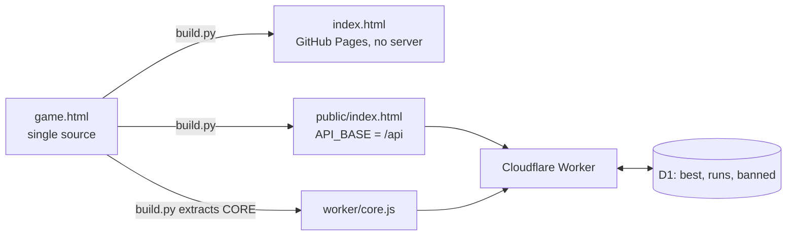

# Cake Stack

A one-tap stacking game for Lauren and Jackson's wedding website (OceanCliff, 2 September 2027).

Tap to drop each tier of the cake. Whatever hangs over the edge is sliced off. Three perfect
drops in a row and the cake starts growing back. Every score on the leaderboard becomes a flag
on the way up, so you watch yourself climb past the rest of the family.

**Play:** https://jtwood25-2.github.io/lj-cake-stack/ (scores stay on each device until the
Cloudflare copy below is live)

## How it is built



| File | Role |
|---|---|
| `game.html` | The whole game. Page content only, no `<html>`/`<head>`, so it also works as the claude.ai preview. |
| `admin.html` | Moderation page, served at `/admin`. Remove a score, or remove and block the name. |
| `worker/index.js` | Score server: issues run tokens, verifies and records scores, serves the static files. |
| `schema.sql` | D1 tables. |
| `build.py` | Generates `index.html`, `public/`, and `worker/core.js`. All generated files are rebuilt on every deploy; never edit them. |
| `test/smoke.mjs` | Checks every server rule, including the cheating attempts, against a local or live server. Removes its own test player. |

## How a score is verified

The phone never reports a score. It reports **when it tapped**, and the server works the score
out itself.

```mermaid
sequenceDiagram
    participant P as Phone
    participant W as Worker
    participant D as D1
    P->>W: POST /api/start (before the run, prefetched)
    W-->>P: token = id . issued-at . HMAC
    Note over P: plays; records ms between each tier appearing and each tap
    P->>W: POST /api/score {token, name, taps}
    W->>W: check HMAC, token age at least the run's length
    W->>W: replay(taps) with the game's own core
    W->>D: insert run (token id is the key, so once only)
    W->>D: upsert best score for the name
    W-->>P: verified score + top 20
```

This works because the game is deterministic: a tier's position is a closed-form function of
the time since it appeared (`posAt`), not a per-frame accumulation, so a list of tap times
replays to the same score anywhere. The block between `CORE-BEGIN` and `CORE-END` in
`game.html` is the only copy of the rules; `build.py` extracts it for the server.

| Attempt | Refused because |
|---|---|
| Edit the score in the request | The server ignores it and replays the taps |
| Invent taps for a big score | They would have to replay to that score, which means actually playing well |
| Post instantly from a script | The token must be at least as old as the run is long |
| Post one great run twice | Each token is accepted once |
| Flood from one network | 120 scores per network per hour (a reception shares one wifi) |
| An offensive name | Removed and blocked from `/admin` |

A bot that genuinely plays in real time is not stopped. Nothing free stops that, and nobody
will build one for a wedding game.

The `best` table keeps one row per player, so each leaderboard load reads about 20 rows and
stays far inside D1's free daily allowance.

## Develop

```bash
npm run dev        # build, then serve on http://127.0.0.1:8787 with a local database
npx wrangler d1 execute cake-stack --local --file schema.sql   # first time only
BASE=http://127.0.0.1:8787 ADMIN_PASSWORD=... npm run smoke
```

Local secrets live in `.dev.vars` (git-ignored): `RUN_SECRET` and `ADMIN_PASSWORD`.

## Deploy to Cloudflare

Needs `CLOUDFLARE_API_TOKEN` (permissions: Workers Scripts Edit, D1 Edit) and
`CLOUDFLARE_ACCOUNT_ID`.

```bash
npx wrangler d1 create cake-stack            # once; put the returned id in wrangler.jsonc
npx wrangler d1 execute cake-stack --remote --file schema.sql
npx wrangler secret put RUN_SECRET           # once each
npx wrangler secret put ADMIN_PASSWORD
npm run deploy
BASE=https://cake.<subdomain>.workers.dev ADMIN_PASSWORD=... npm run smoke
```

GitHub Pages serves `index.html` from `main` and updates about a minute after a push.
